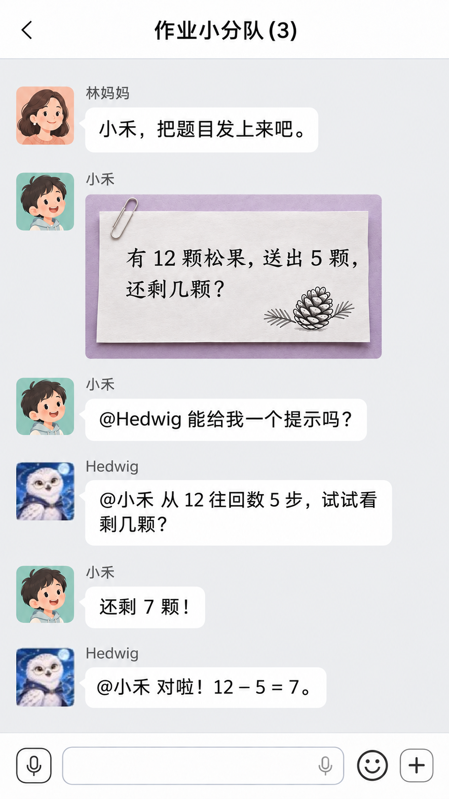

# Hedwig 🦉

由家长自托管的微信学习助手。可以帮助孩子理解作业、检查解题思路、解答问题，也可以用角色互动增加学习趣味。

微信登录和消息收发基于 [Wechaty Puppet Neo](https://github.com/wechaty/puppet-neo)。Hedwig 在固定版本的 Neo 上补充群聊和图片接入，通过本地 Unix socket 把请求交给独立的 AI 服务。模型由部署者配置，默认示例为 DeepSeek。项目与微信官方无隶属关系。

> [!WARNING]
> **请勿使用微信主账号登录。** Hedwig 通过第三方方式接入个人微信，微信可能将其判定为使用外挂或非官方工具，导致功能受限、限制登录或封号。请仅使用专门的测试账号，测试账号同样有风险。参见[《微信个人账号使用规范》存档](https://archive.is/hRlZ4)。

支持私聊和群聊中的文字引用，群聊沿用原本的 @ 和接话规则。视频内容无法读取，问及视频时会说明限制，并可建议发送截图。

## 群聊读图示例

小禾先发一道松果减法题的图片，再 @Hedwig 要提示。Hedwig 引导小禾从 12 往回数 5 步，然后确认孩子自己算出的答案。图中人物和对话均为演示示例。



## 部署

准备一台 Linux ARM64 主机（例如树莓派）、Docker 和 Docker Compose、一个微信测试账号和自己的 AI API Key。首次构建需要访问 GitHub、容器镜像仓库、npm 和 crates.io。

### 1. 填写本地配置

以有 Docker 使用权限的普通用户运行：

```bash
git clone https://github.com/steven-shi/hedwig.git
cd hedwig
cp config.example.json config.json
chmod 600 config.json
mkdir -p run state local logs
chmod 700 run state local logs
printf 'HEDWIG_UID=%s\nHEDWIG_GID=%s\n' "$(id -u)" "$(id -g)" > .env
```

编辑 `config.json`，填入自己的 API Key。只配置一套模型和 Endpoint。例子使用 `deepseek-flash`，支持照片和题目截图。群聊默认关闭，管理员可以先留空。示例里的 `promptFile` 指向仓库自带的 [Hedwig 角色 Prompt](prompts/hedwig-v2.txt)，留空则使用基础学习助手风格。

### 2. 启动并扫码

默认使用终端扫码。想用浏览器扫码的部署者可先配置[内网扫码网页](#内网扫码网页可选)。

```bash
docker compose up -d --build
docker compose exec -T bridge node bridge/login-qr.mjs
```

第二条命令把二维码打印在当前终端并退出。用测试账号扫码，在手机上确认。Docker 会在后台保持微信会话，你可以退出 SSH。二维码未准备好时，等几秒再运行显示命令。终端模式下，二维码过期且桥接已退出时，运行 `docker compose up -d bridge` 再获取新码。启用了内网页面的部署可直接在浏览器发起扫码。

用另一个微信账号发一句「先给我一个提示，怎么比较四分之三和三分之二？」即可检查私聊。也可以发一张去掉姓名和学校的作业截图，让 Hedwig 解释解题步骤。

### 3. 设置家长管理员（可选）

```bash
docker compose exec -T bridge node bridge/admin.mjs identify
```

按终端提示，用家长微信私聊发送一次核验命令。随后在终端查看内部 ID：

```bash
docker compose exec -T bridge node bridge/admin.mjs id
```

把内部 ID 填入 `config.json` 的 `adminWechatId`，执行下方的 AI 重载。以后家长可以在私聊中发 `!status` 或 `!help`。识别以微信消息的发信人内部 ID 为准，显示名不影响权限。

### 日常维护

- 修改 Endpoint、API Key、模型、管理员或 Prompt 后，运行 `docker compose up -d --no-deps --force-recreate ai`。微信桥接可以保持在线，AI 内存里的对话历史会清空。
- 要开启或关闭群聊，修改 `groupsEnabled`，重载 AI 后运行 `docker compose restart bridge`。桥接重启需要重新扫码。启用了扫码网页时，打开页面并手动取码。群内真实 @ 开启接话窗口，单发 🤫 关闭。
- 登录二维码、管理员内部 ID、真实的 `config.json` 和运行状态都属于本地数据。

### 内网扫码网页（可选）

扫码网页由桥接容器提供，和 AI 一起用同一套 Docker Compose 部署。网页适合只在可信内网使用。

1. 在部署目录创建 `local/`，在 `local/bridge.json` 中加入 `qrWeb`。以下用 `192.168.1.20` 举例。保留文件中已有的其他配置项。

   ```json
   {
     "qrWeb": {
       "origin": "http://192.168.1.20:8765"
     }
   }
   ```

2. 在现有的 `.env` 中加入 `HEDWIG_QR_BIND=192.168.1.20`。如果要使用其他端口，加 `HEDWIG_QR_PORT`，并同步修改 `origin` 的端口。网页无需口令，默认接受可达的私有 IPv4 网段。可以加上 `"network": "192.168.1.0/24"` 限制来源。已有单网段配置需要跨网段访问时，删除 `network` 一项。升级前若已有服务占用扫码页端口，先释放端口或改用其他端口。请勿将这个端口转发到公网。
3. 首次部署执行 `docker compose up -d --build`。升级现有部署时，可以先构建桥接，准备好扫码后再替换它：

   ```bash
   git pull --ff-only
   docker compose build bridge
   docker compose up -d --no-deps --no-build --force-recreate bridge
   ```

在可达的内网打开配置的地址，点击 **获取登录二维码**，用微信测试账号扫码并在手机上确认。取码请求必须来自同一网页地址。

- **已在线**：网页显示在线，重复点击或刷新不会发起新登录。
- **连接中断**时，桥接保留当前会话，尝试恢复心跳、通知和同步。最多退避 9 次，等待间隔最长 30 秒，累计最多等待 150 秒，另计请求耗时。可以刷新查看重连状态。恢复前暂停发消息，不重发结果不确定的消息。
- **会话结束**后，页面继续运行。微信拒绝续期、重试耗尽或遇到其他无法恢复的错误时，可以手动取新码。桥接进程重启后仍需扫码。
- **二维码过期或扫码取消**：本轮结束后，同一个页面可以重新取码。页面不会自动反复申请二维码。

不设置 `qrWeb` 时，继续使用终端扫码模式。修改扫码网页配置后，需要重新创建桥接才能生效。

### 朋友圈自动点赞（可选）

在 Pi 的 `local/bridge.json` 中设置 `"momentsAutoLike": true`，并用专用测试号登录桥接。首次刷新只记录首页作为基线。此后每 12 小时读取一次首页，最多取 10 条。只处理基线之后的新好友动态，已赞和自己的动态直接跳过，状态未知的动态留待后续首页判断。

程序在提交前把帖子 ID 记入桥接持久化状态，同一帖子只尝试一次。每轮读取同时获得点赞状态，提交后不发起额外查询。重新登录同一账号时沿用记录。微信离线时暂停。如果两次刷新之间新增超过 10 条，较早的动态可能已滑出首页。

### 微信掉线脚本（可选）

在同一个 `local/bridge.json` 中加入 `alertScript`，设置要调用的本地脚本文件名。使用扫码网页时保留已有的 `qrWeb`：

```json
{"alertScript": "alert.mjs"}
```

把脚本放在 `local/alert.mjs`，赋予执行权限，并让它使用桥接容器中已有的解释器。Compose 会将这个目录只读挂入桥接，Git 会忽略它。

已登录的微信会话掉线时，桥接会读取该配置，把 `wechat_logout` 和 UTC 时间作为两个参数传给脚本。重连过程中不会触发通知。脚本应在 12 秒内完成。正常停机和扫码超时不会调用脚本。通知脚本及其配置可直接在本地更新。

### 日志

在 `./logs/` 查看桥接和 AI 的结构化事件。每个服务保留当前日志和上一份轮转日志，单份约 1 MiB。Docker 也会轮转 `docker compose logs` 的输出。升级现有部署前以部署用户创建 `./logs/` 并设为 0700。`wechat_reconnecting`、`wechat_reconnected` 和 `wechat_read_failed` 记录读取阶段、重试次数以及可用的错误类别和服务端数字代码。

## 家长需要知道的边界

- 适合讲解、答疑和角色互动。默认学习说明鼓励先用提示和示例引导孩子自己尝试；考试期间不代答。这些是模型提示，家长仍应监督，模型也可能答错。
- 文字和需要识别的图片会发给所配置的模型服务商。请勿发送身份证件、联系方式或含个人信息的作业照片。开启群聊前请告知群成员，群聊打开后近期文字也可能随问题发给模型。
- Hedwig 在发往模型的群上下文字段里使用临时成员编号。消息正文和图片仍可能包含个人信息。服务商如何处理输入数据，取决于你使用的服务。
- 示例角色取材于《哈利·波特》，以可选同人示例提供。实时天气、长期记忆和提醒工具尚未接入。

开发验证可运行 `npm test`，需要 Node.js 26 及本地 Unix socket 权限。

## 许可证

Hedwig 自有代码采用 [Apache-2.0](LICENSE)。依赖及可选角色示例的归属见[第三方说明](docs/THIRD_PARTY.md)。
